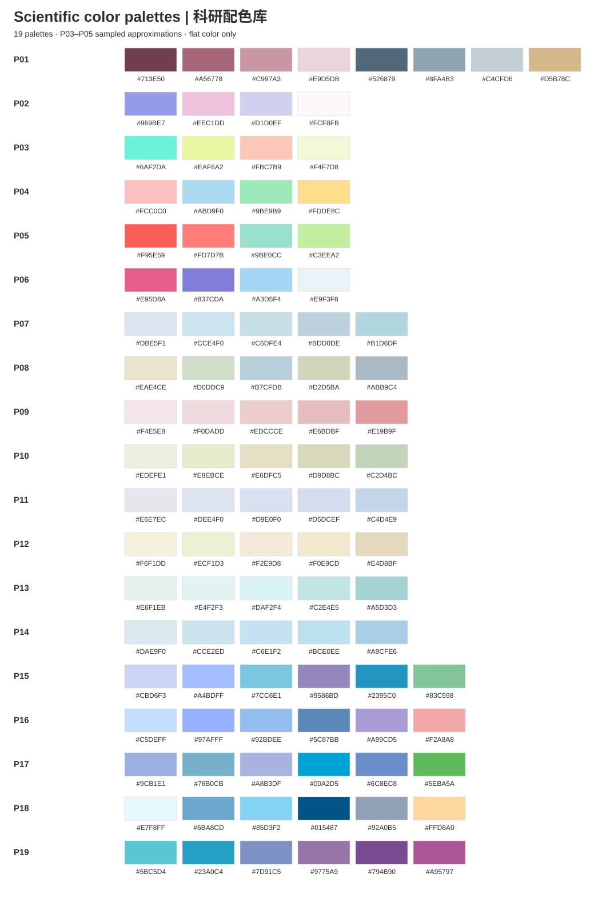

# 科研配色库 · v1.3

19组色卡按用户提供参考图片的顺序整理，仅以 P01–P19 编号标识色卡，适用场景为编辑建议。P03–P05为近似色块采样，其他按可辨色号记录。参考图中渐变、立体光影、图表数据和原始插图不属于本配色库；仅保留颜色，不转载图片，也不宣称这些是任何期刊官方色板。

[机器可读 JSON](color-palettes.json) · [全部色卡预览](color-palettes.svg)

| 编号 | HEX | 建议用途（可调整） | 取值依据 |
|---|---|---|---|
| P01 | #713E50 #A56778 #C997A3 #E9D5DB #526879 #8FA4B3 #C4CFD6 #D5B78C | 对照、材料表征、证据比较 | 图示HEX |
| P02 | #969BE7 #EEC1DD #D1D0EF #FCF8FB | 柔和概念图、分类示意 | 图示HEX |
| P03 | #6AF2DA #EAF6A2 #FBC7B9 #F4F7D8 | 轻柔辅助区室、概念图 | 近似采样 |
| P04 | #FCC0C0 #ABD9F0 #9BE9B9 #FDDE8C | 分类概念、不同对象 | 近似采样 |
| P05 | #F95E59 #FD7D7B #9BE0CC #C3EEA2 | 冷暖对照、重点提示 | 近似采样 |
| P06 | #E95D8A #837CDA #A3D5F4 #E9F3F8 | 多组分类、少量重点强调 | 图示HEX |
| P07 | #DBE5F1 #CCE4F0 #C6DFE4 #BDD0DE #B1D6DF | 流程分区、浅色填充 | 图示HEX |
| P08 | #EAE4CE #D0DDC9 #B7CFDB #D2D5BA #ABB9C4 | 组织区室、背景辅助色 | 图示HEX |
| P09 | #F4E5E8 #F0DADD #EDCCCE #E6BDBF #E19B9F | 同一对象的有序层级 | 图示HEX |
| P10 | #EDEFE1 #E8EBCE #E6DFC5 #D9D8BC #C2D4BC | 生态、组织背景及层级 | 图示HEX |
| P11 | #E6E7EC #DEE4F0 #D9E0F0 #D5DCEF #C4D4E9 | 低干扰层级、辅助区域 | 图示HEX |
| P12 | #F6F1DD #ECF1D3 #F2E9D8 #F0E9CD #E4D8BF | 浅色辅助区域、分区 | 图示HEX |
| P13 | #E6F1EB #E4F2F3 #DAF2F4 #C2E4E5 #A5D3D3 | 医学示意、阶段背景 | 图示HEX |
| P14 | #DAE9F0 #CCE2ED #C6E1F2 #BCE0EE #A9CFE6 | 层级表达、水系蓝辅助填充 | 图示HEX |
| P15 | #CBD6F3 #A4BDFF #7CC6E1 #9586BD #2395C0 #83C598 | 多类别示意、机制图 | 图示HEX |
| P16 | #C5DEFF #97AFFF #92BDEE #5C87BB #A99CD5 #F2A8A8 | 多组对照、细胞概念图 | 图示HEX |
| P17 | #9CB1E1 #76B0CB #A8B3DF #00A2D5 #6C8EC8 #5EBA5A | 多模块流程、分类 | 图示HEX |
| P18 | #E7F8FF #6BA8CD #85D3F2 #015487 #92A0B5 #FFD8A0 | 主次关系、冷暖对照 | 图示HEX |
| P19 | #5BC5D4 #23A0C4 #7D91C5 #9775A9 #794B90 #A95797 | 复杂多类别关系、机制概念 | 图示HEX |

## 使用原则

绘图前先展示3–5组与科学内容相符的实际色块（编号、HEX及推荐理由；不另设色卡名称），允许用户选编号、自定义、沿用此前确认的方案或让AI自行搭配。可使用SVG/HTML色卡或客户端支持的色块展示，不只列编号。已有明确色彩要求不重复确认；未明确且未授权代选时等待选择后再画正式图。若用户没有偏好，自选最适合的一组并告知理由；在同一论文中沿用统一语义映射。默认纯白背景；深灰用于文字和必要轮廓，浅色用于填充，较深且有对比度的颜色用于关键对象、连线和数据标记。低饱和近色组不能单靠色相区分不同类别，必要时增加深色描边、形状、线型或直接标签。任何调整记录原色值和最终HEX。保留既有协和绿等自定义配色作为另一个选项。不使用参考图的渐变、阴影、纹理或3D效果。
